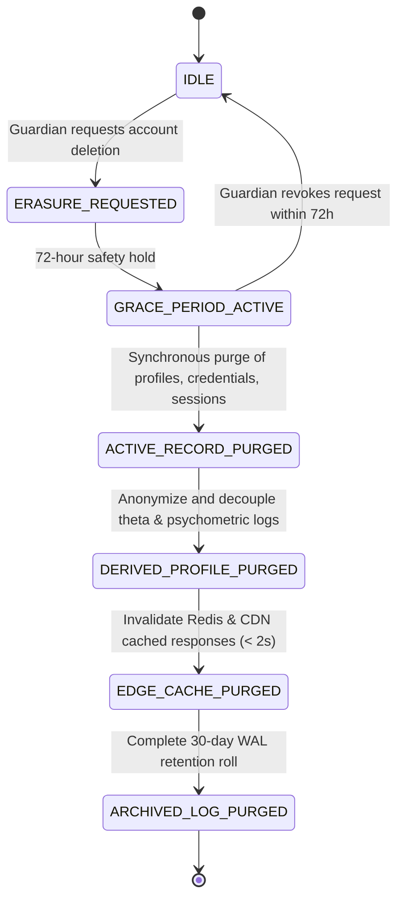

# CREED OS — DPDP Act 2023 Statutory Child Protection & Consent Manifest

**Document Version:** 2026.1-DPDP-STATUTORY  
**Jurisdiction:** Republic of India  
**Governing Statute:** The Digital Personal Data Protection Act, 2023 (Act No. 22 of 2023)  
**Target Learner Demographics:** Core Cohort Classes 5–10 (Ages 10–16); Modular Cohort Classes 3–12 (Ages 8–18)  
**Statutory Child Definition:** Section 2(f) — "child" means an individual who has not completed the age of eighteen years.

---

## 1. Statutory Obligations & Architectural Mappings

| DPDP Section | Statutory Requirement | CREED OS Architectural Implementation | Verification Mechanism |
|---|---|---|---|
| **Section 5** | **Notice Requirement:** Clear, plain notice specifying personal data collected, purposes, and grievance redressal before or during consent request. | Implemented via canonical `CANONICAL_DPDP_NOTICE` in `@core-os/domain` and rendered in the multi-lingual `/parent/consent` interface with English and Hindi statutory declarations. | Automated unit tests in `dpdp-lifecycle.test.ts`. |
| **Section 6** | **Consent Integrity:** Consent must be free, specific, informed, unconditional, and unambiguous with a clear affirmative action. | Consent requires affirmative multi-factor verification (DigiLocker / SMS OTP). Re-consent required upon version bump (`v1.2-dpdp-2023`). | State machine guards in `transitionConsentState`. |
| **Section 9(1)** | **Verifiable Parental Consent:** Mandatory verifiable parental consent before processing any personal data of a minor under 18 years. | Automated birthdate check `isMinorRequiringConsent()`. Assessment token generation blocked with HTTP 403 (`CONSENT_REQUIRED`) if active consent is missing. | Server hook in `hooks.server.ts` & negative test suite `security-negative.test.ts`. |
| **Section 9(2)** | **Detriment Prohibition:** Prohibition against processing that causes any detrimental effect on the well-being of a child. | Strict elimination of deterministic IQ scores, high-stakes percentage rankings, or irreversible career disqualification. Qualitative developmental tiers only (*"Strong foundation"*). | WAY 2.1 design system audit assertion `Zero False Precision`. |
| **Section 9(3)** | **Tracking & Ad Prohibition:** No behavioral tracking, profiling, or targeted advertising directed at children. | Zero advertising pixels or 3rd-party commercial trackers. Data is strictly relationship-isolated via Supabase PostgreSQL RLS. | Supabase RLS test harness (`supabase/tests/rls_test_harness.sql`). |
| **Section 12** | **Right to Erasure:** Obligation to erase personal data upon consent withdrawal or purpose fulfillment. | 6-Tier account erasure engine (`advanceErasureStage`) enforcing active purge, derived metric anonymization, and rolling backup lifecycle. | Vitest verification in `dpdp-lifecycle.test.ts`. |
| **Section 13** | **Grievance Redressal:** Designated Data Protection Officer (DPO) and rapid dispute resolution. | DPO published prominently in all notices: Adv. Aditi Deshmukh (`dpo@creed-os.app`). | Canonical manifest declaration. |

---

## 2. Six-Tier Account & Evidence Erasure Lifecycle

---

## 3. Legal Review Status

This statutory child protection manifest is pre-configured for formal certification under **Release Gate 3 (DPDP Child Privacy)** by qualified Indian privacy counsel prior to platform production deployment.
